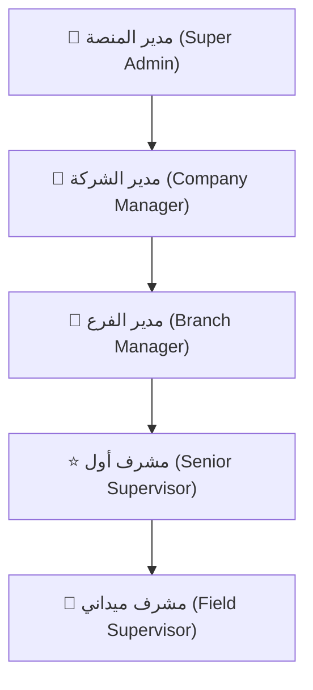
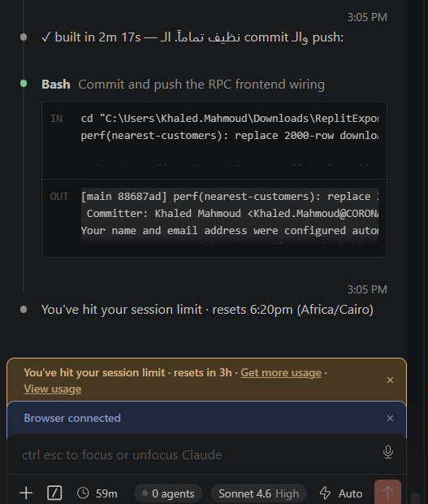
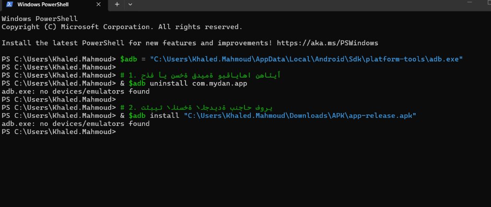
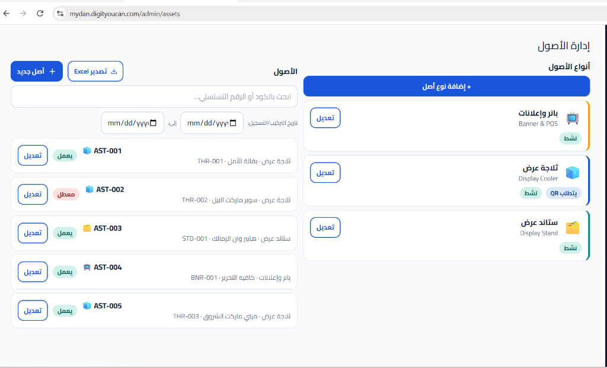
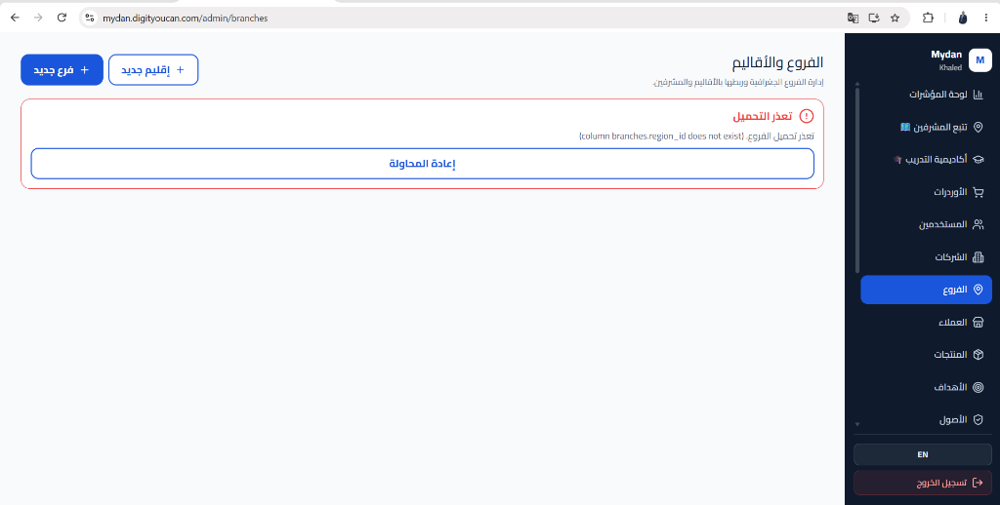
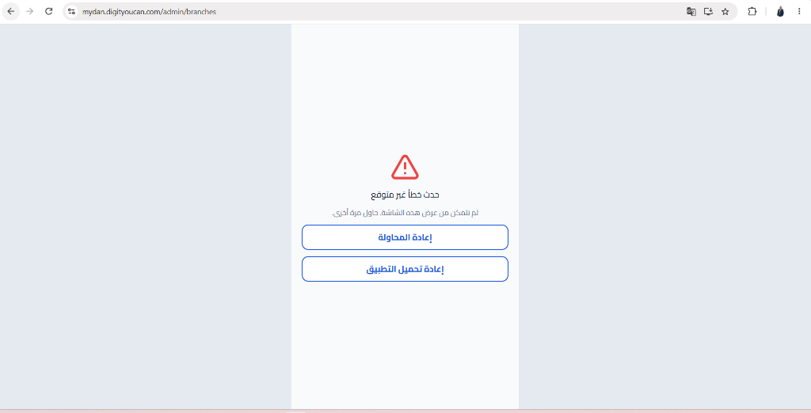
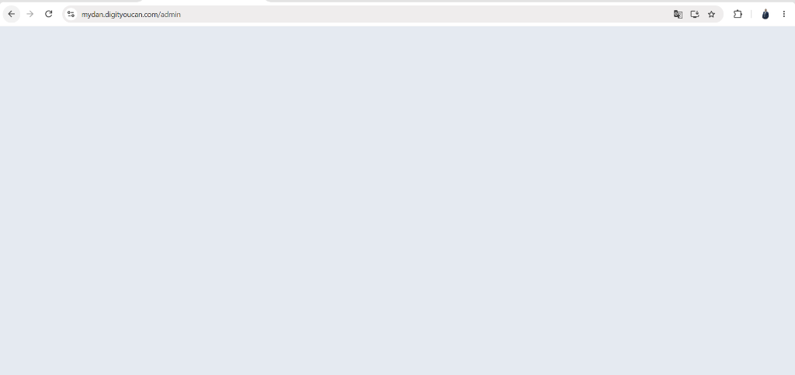
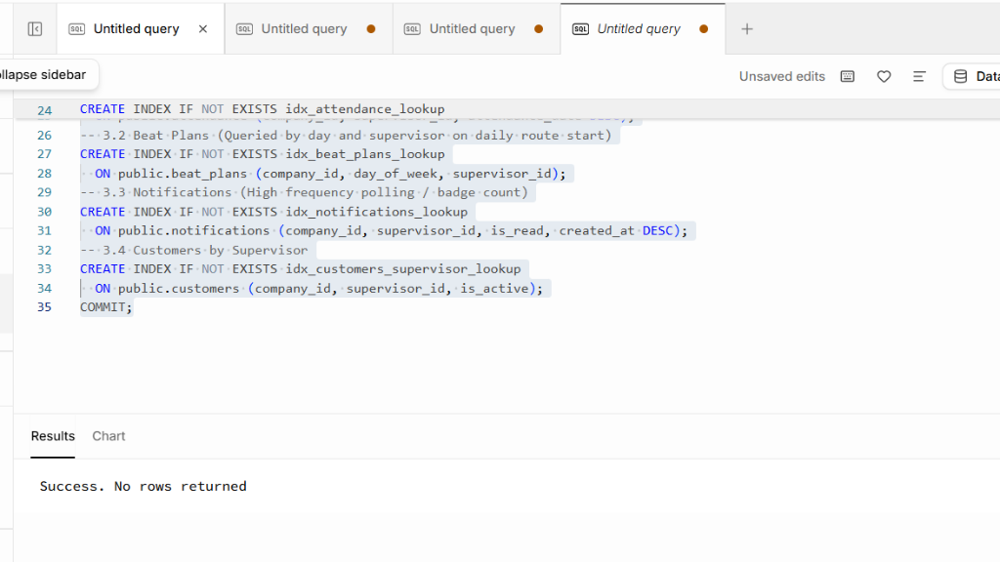

# 📱 دليل المستخدم ودليل النظام الشامل — تطبيق ميدان (Mydan)
### نظام إدارة ومتابعة قوى البيع الميدانية والتدقيق بالذكاء الاصطناعي (AI Field Sales & Shelf Audit Platform)

---

## 🌟 نظرة عامة على النظام (Executive Summary)

**ميدان (Mydan)** هو حل برمجي سحابي متكامل ومتقدم (Enterprise-Grade SaaS) مصمم خصيصاً لإدارة وأتمتة فرق المبيعات والمشرفين الميدانيين في شركات التوزيع والتجزئة والسلع الاستهلاكية سريعة الدوران (FMCG).

يجمع النظام بين:
1. **تطبيق هاتف هجين ذكي (Android & PWA)** مزود بتحديثات هوائية فورية (Live OTA).
2. **لوحة تحكم إدارة شاملة (Back-Office Admin Portal)** لمتابعة الحركة الحية وإصدار التقارير.
3. **محرك تدقيق الرفوف بالذكاء الاصطناعي (AI Shelf Review)** عبر Google Gemini Vision للتعرف على المنتجات والمنافسين ونسبة التواجد (Share of Shelf).
4. **محرك المزامنة عند انقطاع الإنترنت (Offline-First Engine)** للعمل في المناطق النائية.
5. **نظام التحقق الجغرافي الصارم (Geofencing)** لمنع الزيارات الوهمية وضمان وصول المشرف لنقطة البيع.

---

## 👥 الأدوار والصلاحيات في النظام (User Roles & Personas)

* **مدير المنصة (Super Admin):** إدارة الشركات، الباقات، الاشتراكات، ومفاتيح النظام العامة.
* **مدير الشركة / الفرع (Company / Branch Manager):** إدارة الفروع، كتالوج المنتجات وقوائم الأسعار، بيانات العملاء، ومراقبة حركة المشرفين الحية على الخريطة.
* **المشرف الميداني (Field Supervisor):** تسجيل الحضور والانصراف، تنفيذ خط السير اليومي، تسجيل الزيارات الجغرافية، تدقيق الرف بالصور، حصر المنافسين، وتسجيل طلبات البيع.

---

## 🚀 الباب الأول: دليل المشرف الميداني (Mobile Field App Guide)

### 1.1 تسجيل الدخول والأمان (Login & Device Binding)

1. افتح تطبيق ميدان على الهاتف أو الرابط عبر المتصفح.
2. أدخل **البريد الإلكتروني** و**كلمة المرور**.
3. **سياسة ربط الجهاز (Device Binding):**
   * عند أول تسجيل دخول من هاتف عمل، يُربط الحساب بمعرّف الجهاز (Device ID).
   * يُمنع الدخول من أي هاتف آخر لضمان عدم مشاركة الحساب أو التلاعب بالموقع الجغرافي.
   * لإلغاء الربط وتغيير الهاتف، يرجى مراجعة إدارة الشركة.
4. **حماية التخمين (Brute-Force Lockout):**
   * في حال إدخال كلمة المرور بالخطأ 5 مرات متتالية، يتم قفل المحاولة لمدة **60 ثانية** مع عداد تنازلي لحماية الحساب.
5. **التحديث الهوائي الفوري (Live OTA Updates):**
   * التطبيق يتصل مباشرة بالسيرفر السحابي؛ أي تحديث أو ميزة جديدة يطلقها المطورون تظهر فوراً على هاتفك دون الحاجة لتثبيت ملف APK جديد.

---

### 1.2 لوحة المتابعة وتسجيل الحضور والانصراف (Dashboard & Attendance)

بمجرد تسجيل الدخول، تظهر الشاشة الرئيسية وتضم:

1. **كارت تسجيل الحضور والانصراف (Attendance Widget):**
   * **قبل البدء (برتقالي):** يظهر زر `تسجيل حضور`. بالضغط عليه تظهر نافذة تأكيد بالوقت والتاريخ لتسجيل الحضور مع إحداثيات الـ GPS.
   * **أثناء يوم العمل (أزرق):** يظهر وقت الحضور بالدقيقة والثانية مع زر أحمر `تسجيل انصراف`.
   * **بعد إتمام اليوم (أخضر):** يتحول الكارت إلى شريط نجاح يعرض وقت بدء العمل وانتهائه.
2. **المؤشرات الحيوية اليومية (Daily KPIs):**
   * **زيارات اليوم:** عدد الزيارات المنفذة مقارنة بالمجدولة.
   * **مراجعات الرف:** عدد عمليات التدقيق الذكي المنفذة اليوم.
   * **نسبة الهدف %:** النسبة المئوية لإنجاز الهدف اليومي.
3. **أزرار الوصول السريع (Quick Actions):**
   * `زيارة جديدة`: لبدء زيارة عميل فوري.
   * `مراجعة الرف`: لفتح كاميرا التدقيق الذكي.
   * `أكاديمية التدريب`: للوصول للمواد التدريبية والفيديوهات.
   * `الأوردرات`: لاستعراض وإنشاء فواتير الطلبيات.
   * `خطة الزيارات`: لاستعراض خط السير اليومي والأسبوعي.
   * `مسح ميداني`: لاكتشاف وإضافة نقاط بيع جديدة.

---

### 1.3 خط السير وخوارزمية تحسين المسار (Beat Plan & Route Optimizer)

* يحدد النظام جدول الزيارات لكل يوم من أيام الأسبوع تلقائياً.
* **زر تحسين المسار بالذكاء الاصطناعي (Optimize Route TSP):**
  * يقوم النظام بحساب المسافات الجغرافية بين نقاط بيع اليوم.
  * يرتب العملاء من الأقرب إلى الأبعد لتقليل زمن وتكلفة الانتقال واستهلاك الوقود، مع عرض الكيلومترات الموفرة.
* إمكانية فتح موقع العميل مباشرة على خرائط Google عبر زر التوجيه المدمج.

---

### 1.4 تنفيذ الزيارات والسياج الجغرافي (Geofenced Visits)

1. عند الوصول للعميل، اضغط `بدء زيارة`.
2. **التحقق من السياج الجغرافي (Geofencing Verification):**
   * يقوم التطبيق بقراءة موقع الهاتف ومقارنته بإحداثيات العميل المسجلة.
   * **داخل النطاق (أقل من 200 متر):** تُسجل الزيارة تلقائياً كزيارة معتمدة (On-Beat).
   * **خارج النطاق (أكثر من 200 متر):** تظهر رسالة تنبيه تفاعلية تفيد ببعد المشرف عن الموقع، ويلزم تسجيل سبب التواجد خارج النطاق مع قفل الزيارة كـ (Out of Range) لضمان الشفافية.
3. **المهام داخل الزيارة (Visit Tasks):**
   * مراجعة المخزون والرفوف.
   * تصوير واجهة المحل أو الرف.
   * تسجيل أوردر البيع وتحديد الأصناف.
   * تسجيل نتيجة الزيارة (تم البيع، المحل مغلق، المدير غير موجود، إلخ).

---

### 1.5 تسجيل الطلبيات والمبيعات ومشاركتها (Orders & WhatsApp Sharing)

1. داخل الزيارة أو من شاشة `الأوردرات`، اضغط `أوردر جديد`.
2. حدد الكمية لكل صنف مع خيار التحديد بالـ (قطعة أو كرتونة).
3. يحتسب النظام الإجمالي، الخصومات، والضريبة تلقائياً بناءً على قائمة أسعار الشركة المعتمدة.
4. اضغط `حفظ الأوردر`.
5. **مشاركة الفاتورة بنقرة واحدة عبر واتساب (WhatsApp 1-Click Share):**
   * فور الحفظ، يُتاح زر إرسال ملخص الفاتورة المنسق بصيغة رسمية واضحة إلى رقم هاتف العميل مباشرة.

---

### 1.6 التدقيق الذكي للرفوف بالذكاء الاصطناعي (AI Shelf Review)

1. اختر العميل والزيارة واضغط `التقاط صورة الرف`.
2. يقوم محرك ضغط الصور المدمج بضغط الصورة من 8 ميجابايت إلى أقل من 300 كيلوبايت لتوفير باقة الهاتف وسرعة الرفع.
3. يقوم نموذج الذكاء الاصطناعي (Google Gemini Vision) بتحليل الصورة وإصدار تقرير فوري خلال ثوانٍ يشمل:
   * **درجة التوافق والامتثال (Planogram Score out of 100).**
   * **حصة الرف للعلامة التجارية (Share of Shelf %).**
   * **حالات النواقص ونفاد المخزون (Out-of-Stock Detection).**
   * **كشف منتجات وعروض المنافسين على نفس الرف.**
   * **توصيات فورية للمشرف لتحسين العرض.**

---

### 1.7 العمل دون اتصال بالإنترنت (Offline Mode & Auto Sync)

* في حال انقطاع تغطية الشبكة في المخازن أو المناطق الريفية، يستمر التطبيق بالعمل بكامل كفاءته.
* تُخزن كافة الحركات (الزيارات، الإحداثيات، الأوردرات، الحضور) محلياً في ذاكرة مشفرة (IndexedDB).
* فور عودة الاتصال، يظهر مؤشر المزامنة في الشريط العلوي وتُرفع كافة البيانات المعلقة تلقائياً إلى الخادم مع إشعار للمشرف.

---

## 🏢 الباب الثاني: دليل لوحة الإدارة والتحكم (Back-Office Admin Guide)

### 2.1 إدارة المشرفين والمستخدمين (Supervisors & Permissions)

من خلال شاشة `إدارة المستخدمين`:
1. **إضافة مشرف جديد:** كتابة الاسم، البريد الإلكتروني، رقم الهاتف، الفرع التابع له، ونوع الصلاحية.
2. **تفعيل / تعطيل الحساب:** إيقاف المشرف مؤقتاً عند الإجازات أو ترك العمل بنقرة واحدة.
3. **إلغاء ربط الجهاز (Reset Device Binding):** للسماح للمشرف بربط هاتف جديد عند تلف أو استبدال هاتفه القديم.
4. **الحذف النهائي مع التأكيد الأمني (Hard Delete with Confirmation Modal):**
   * لحذف المستخدم نهائياً وتنظيف كافة سجلاته، يتطلب النظام تأكيداً عبر نافذة مخصصة لمنع الحذف بالخطأ.

---

### 2.2 الخريطة الميدانية الحية (Live Supervisor Map)

* استعراض مواقع المشرفين الميدانيين لحظة بلحظة على خريطة Leaflet تفاعلية.
* تمييز حالة المشرف:
  * 🟢 **أخضر:** متواجد حالياً داخل زيارة عميل.
  * 🟡 **برتقالي:** مسجل حضور ومتحرك بين العملاء.
  * ⚪ **رمادي:** غير مسجل حضور اليوم أو خارج الخدمة.
* الضغط على أي مشرف يعرض تفاصيل يومه: عدد الزيارات المنفذة، نسبة التزامه بالمسار، ووقت آخر زيارة.

---

### 2.3 إدارة العملاء ونقاط البيع (Customers & Outlets)

* إضافة وتعديل العملاء مع تحديد نوع النشاط (سوبرماركت، كشك، جملة، قطاعي).
* تعيين الموقع الجغرافي الدقيق للعميل عبر الـ GPS بنقرة واحدة من موقع المحل.
* استيراد وتصدير بيانات العملاء بآلاف السجلات دفعة واحدة عبر ملفات Excel و CSV معالجة بنظام الدفعات السريع (Batches of 50).

---

### 2.4 إدارة الأصناف وقوائم الأسعار (Products & Catalogs)

* تسجيل الأصناف مع تحديد الباركود، كود الـ SKU، العلامة التجارية الرئيسية والفرعية.
* ضبط سعر القطعة وسعر الكرتونة وعدد الوحدات داخل الكرتونة لضمان دقة حسابات الأوردرات في الميدان.

---

### 2.5 التقارير والتحليلات (Reports & Analytics)

* تقرير إنتاجية المشرفين اليومية والأسبوعية والشهرية.
* تقرير تغطية خط السير ونسبة الالتزام بالسياج الجغرافي.
* تقرير فواتير المبيعات والأصناف الأكثر مبيعاً.
* تقرير تحليلات الرفوف وتواجد المنافسين مدعوماً بصور الذكاء الاصطناعي.
* إمكانية تصدير كافة التقارير بصيغة CSV و Excel بضغطة زر.

---

## ⚙️ الباب الثالث: المواصفات الفنية ومتطلبات التشغيل (Technical Specifications)

| البند | المواصفة الفنية |
| :--- | :--- |
| **قاعدة البيانات** | PostgreSQL 15+ مع امتدادات PostGIS و RLS (عزل أمني للشركات Multi-Tenant). |
| **تقنية الواجهة** | React 18, TypeScript, Tailwind CSS, Lucide Icons, TanStack Query. |
| **تطبيق الهاتف** | Capacitor Android + Progressive Web App (PWA) قابل للتثبيت على كافة الهواتف. |
| **محرك التحديث** | Live Remote OTA Architecture (تحديث فوري دون الحاجة لإعادة رفع APK). |
| **محرك الذكاء الاصطناعي** | Google Gemini Vision (معالجة وتحليل صور الرفوف). |
| **الخرائط** | Leaflet OpenStreetMap Engine مع خوارزميات Haversine و TSP لحساب أقصر مسار. |
| **الاستضافة المعتمدة** | Cloudflare Pages (Frontend) + Supabase Enterprise (Backend & DB). |

---

## 📞 الدعم الفني وخدمة ما بعد البيع (Support & Contact)

* **البريد الإلكتروني:** support@digityoucan.com
* **النطاق المباشر للمعاينة:** [https://mydan.digityoucan.com](https://mydan.digityoucan.com)
* **المستودع البرمجي:** GitHub Main Branch (Private Enterprise License)

> **تم إعداد وتنسيق هذا الدليل ليكون وثيقة رسمية جاهزة للتقديم والتسويق في المتاجر الرقمية وعروض المشروعات.**
